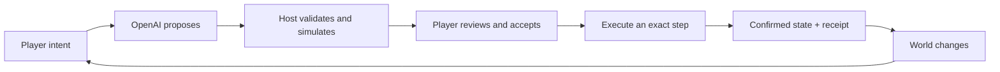

# Runtime Story SDK

[](https://cyberlane.github.io/runtime-story-sdk/)

**Game-owned mechanics. Player-driven plans. Consequences that stay.**

[Explore the visual showcase](https://cyberlane.github.io/runtime-story-sdk/) · [Watch the developer demo](https://youtu.be/0kfqFjjUfLY) · [Start building](docs/QUICKSTART.md)

Built for the **OpenAI × Tokyo AI Game Builder Challenge, Track 2: game-production tools**. Runtime Story turns a player's free-form intention into a proposed sequence of mechanics your game already supports. Your rules validate the plan. The player accepts its terms. Your host commits each action, with a receipt that makes exact retries safe.

When the world changes, players can revise unfinished work while keeping completed actions, resources and accepted constraints. OpenAI interprets the intention and composes a candidate. Your game owns what can actually happen.

## Try it

Requirements: **Node.js 22.12+**, npm, and a modern browser. All commands below run from the repository root.

```sh
git clone https://github.com/Cyberlane/runtime-story-sdk.git
cd runtime-story-sdk
npm ci
npm test
npm run demo:emberwake
```

Open **http://127.0.0.1:4340**. Emberwake's map, combat, rescue and inventory work immediately without an API key. For a live plan, configure a provider using the [quickstart](docs/QUICKSTART.md#configure-a-live-provider). The included Codex CLI provider uses your local authenticated installation. A deployed host should use the server-side Responses API transport or another isolated provider.

For a complete offline planning example with no model account:

```sh
node docs/integrations/snippets/first-plan.mjs
```

The SDK is included as an npm workspace under **`@off-script/runtime-story`**. It is not published to the npm registry. The repository is named Runtime Story SDK; the package keeps its original namespace for compatibility.

## Three games, one runtime

| Demo                                     | What it demonstrates                                                                                     | Run                                        |
| ---------------------------------------- | -------------------------------------------------------------------------------------------------------- | ------------------------------------------ |
| [Emberwake](examples/emberwake/)         | A fantasy RPG expedition, resource promises, tactical encounters and replanning after a bridge collapses | `npm run demo:emberwake` → port 4340       |
| [Off Script](examples/off-script/)       | Selective evidence disclosure, host-owned consent rules, shelter and a revised departure                 | `npm run demo:off-script` → port 4320/play |
| [Relay Station](examples/relay-station/) | A small resource-management adapter, HTTP host and native-engine clients                                 | `npm run demo:relay-station` → port 4330   |

Each demo uses the shared SDK. The showcase website is static; run a demo locally to use live inference. Inference may take tens of seconds and depends on your provider, account and model.

## The boundary that matters



- **Registered mechanics:** JSON schemas and synchronous reducers define every supported action. Narration is never executable code.
- **Review before effects:** staging and acceptance spend no resources and move no characters.
- **Exact command receipts:** retry the same branch, revision, plan and step command after a lost response. Do not ask for a new “next step” as a retry.
- **Persistent consequences:** revisions retain completed state and history. Your adapter enforces which promises must survive.
- **Honest unsupported results:** requests can return `needs_context` or `unsupported`, with no executable steps.

## Integrate with your engine

Start with [Your first adapter](docs/QUICKSTART.md), then follow the appropriate tutorial. Each guide includes setup, copyable commands, expected output, a complete request sequence and troubleshooting.

| Engine        | Tutorial                                                  | Verification scope                                   |
| ------------- | --------------------------------------------------------- | ---------------------------------------------------- |
| Web / Node.js | [Build and run your first plan](docs/integrations/WEB.md) | Executable offline example and HTTP regression tests |
| Godot         | [Connect a Godot 4 project](docs/integrations/GODOT.md)   | Native smoke test with the included host             |
| Unity         | [Add the C# client and scene](docs/integrations/UNITY.md) | Source reviewed; native compilation still required   |
| Unreal        | [Add the C++ component](docs/integrations/UNREAL.md)      | Source reviewed; native compilation still required   |

The Node host remains authoritative. Keep model credentials there. Native clients submit intent, review proposals and animate confirmed state. Reducers run during simulation, so they must not directly invoke physics, write files, award external purchases or perform network side effects.

See the [API contract](docs/API.md), [architecture](docs/ARCHITECTURE.md) and [deployment boundaries](docs/KNOWN-LIMITATIONS.md) before adapting the examples to a shipped game.

## Repository map

```text
packages/runtime-story/    The SDK: registry, runtime, planning and providers
examples/emberwake/        Fantasy RPG, art, browser client and tests
examples/off-script/       Narrative game, domain rules and browser presentation
examples/relay-station/    Minimal host, adapter, comparison and engine clients
docs/                     Quickstart, engine tutorials, API and review evidence
site/                     Original artwork and static GitHub Pages showcase
scripts/                  Asset checks and local site preview
.github/workflows/        Tests and GitHub Pages publication
```

## Develop and verify

```sh
npm run check             # All workspace tests, asset integrity and site links
npm run format:check      # Consistent source formatting
npm run site:dev          # Preview the static site locally
npm pack --workspace=@off-script/runtime-story
```

Install the resulting `off-script-runtime-story-0.2.0.tgz` in your own Node host. See [contributing](CONTRIBUTING.md) for the small-change workflow and [review evidence](docs/review/README.md) for what was actually checked.

## Status and evidence

Version **0.2.0** is the public, reviewed release of the competition prototype. It provides a bounded integration foundation with deterministic tests, three working local demos and engine examples. It is not a managed backend: authentication, per-player sessions, durable storage, operating limits and reconciliation with external game effects belong to your production host.

The original comparison had three cases. The SDK, a competent deterministic planner and an equal-information model reference each passed all three. The deterministic planner was faster. The demonstrated value is the reusable intent-to-reviewed-plan workflow, not a measured accuracy or speed advantage. [Comparison method](examples/relay-station/comparison/README.md).

## Event, credits and license

Created by **Justin Nel / Cyberlane** for the [OpenAI × Tokyo AI event](https://luma.com/3kj24doy). This is an independent competition entry. [Project description and reuse disclosure](docs/COMPETITION.md) · [Video](https://youtu.be/0kfqFjjUfLY).

Project code, documentation and original artwork are provided under the [MIT License](LICENSE), to the extent the contributor holds the applicable rights. AI-assisted code and generated artwork are disclosed in [credits](docs/CREDITS.md). Dependencies retain their own licenses in [third-party notices](THIRD_PARTY_NOTICES.md). The externally hosted video is not included in this repository's license grant.
