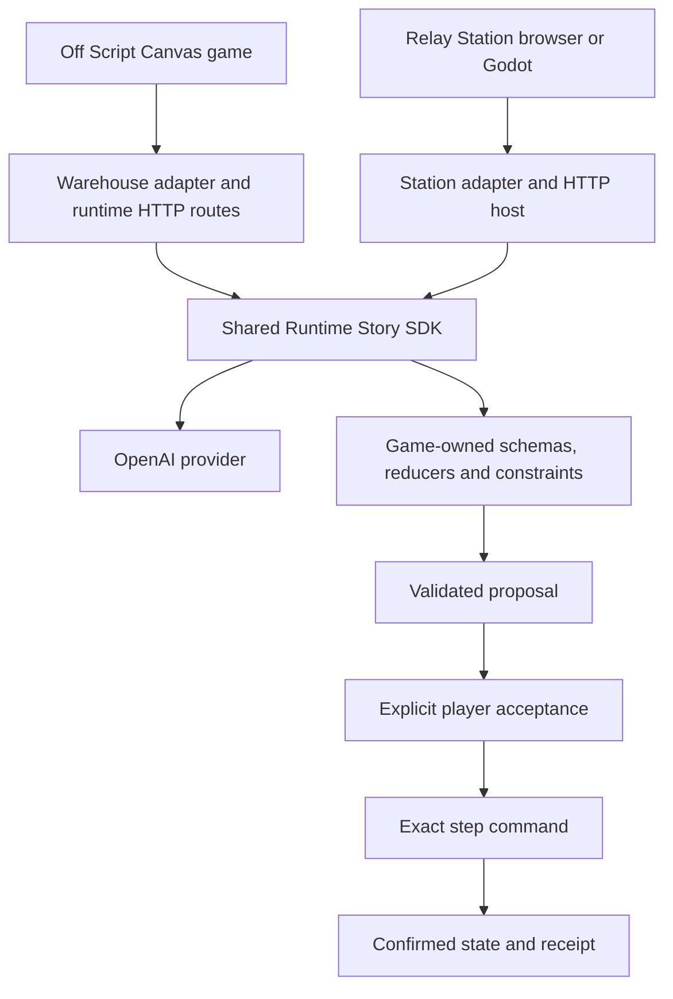

# Architecture

Runtime Story 0.2.0 is a Node-hosted, engine-independent planning and execution package. The engine boundary is JSON over a game-owned adapter. It is not a native engine plugin or an autonomous game designer.

## Ownership

| Layer             | Location                                        | Owns                                                                                                                                              |
| ----------------- | ----------------------------------------------- | ------------------------------------------------------------------------------------------------------------------------------------------------- |
| Showcase          | `examples/off-script/public/`                   | Story staging, input, art, animation, sound, confirmed-state display                                                                              |
| Warehouse adapter | `examples/off-script/src/`                      | Canonical facts, privacy, consent policy, domain operations and UI projection                                                                     |
| Different game    | `examples/relay-station/game.mjs`, `server.mjs` | Resource conservation, repair, surveys, transmission and exact requested outcomes                                                                 |
| Shared package    | `packages/runtime-story/src/`                   | JSON/schema checks, candidate simulation, bounded correction, branches/revisions, acceptance, exact execution, receipts and checkpoint validation |
| Provider          | Package `providers` export                      | Server-side inference transport and provenance                                                                                                    |
| Engine client     | Station Godot, Unity and Unreal samples         | Intent submission, confirmed-state rendering and guarded commands                                                                                 |

The package imports no game source or assets. Each demo depends on the same `@off-script/runtime-story` workspace version. Packing the SDK includes its source, README and license, with Ajv resolved as a dependency. The original competition prototype was 0.1.0; this public repository starts at 0.2.0 after the publication review.

## A request's lifecycle

The model receives registered actions, projected game context, prior accepted history and player intent. It returns structured terms and steps. The package validates shape and simulates the complete candidate with the game's pure reducers, checking intermediate state and final constraints. Only a valid candidate is staged against the captured branch and revision.

The player reviews the terms before acceptance. Acceptance records a plan without executing it. Each subsequent command names the branch, expected revision, plan and exact step. The package revalidates remaining work and commits one transition with its receipt. An identical command retry returns that receipt rather than performing the effect again. Descriptive text has no authority to change state.

An external game event uses trusted `change` to invalidate proposals and interrupt active work. A newly accepted plan supersedes unfinished work. Completed state, receipts and history remain. Restoring a checkpoint creates a new branch, rejecting commands from the abandoned timeline.

## Integration boundary and limits

Reducers are synchronous deterministic computations on frozen JSON copies. Never call native physics, network services, file writes or other external effects inside them: validation invokes them speculatively. Native clients animate confirmed state. A future asynchronous native-effect protocol would need acknowledgement, failure compensation and reconciliation. This version does not supply that protocol.

The host is in memory. An explicit checkpoint contains domain state and receipts together. Durable hosting must persist that envelope atomically before acknowledging durable execution. Current demos do not promise crash durability, distributed exactly-once execution, multiplayer isolation or cryptographic save authenticity.

Off Script serves `/api/runtime/*`; the smaller Relay Station and Emberwake hosts expose their own documented routes. Each process contains one local game session. The website is static and contains no model credentials or live game host.

See [API](API.md), [limitations](KNOWN-LIMITATIONS.md), [Godot](integrations/GODOT.md), [Unity](integrations/UNITY.md) and [Unreal](integrations/UNREAL.md).
